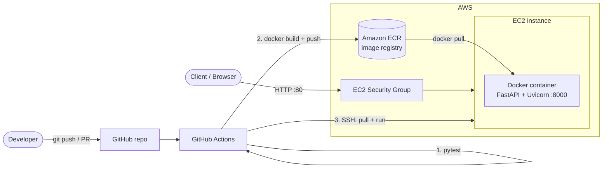

# Notes Microservice (Docker + AWS ECR + EC2)

A small REST microservice built with **FastAPI**, packaged as a **Docker** image, stored in **Amazon ECR**, and deployed on **Amazon EC2** automatically by **GitHub Actions**.

## What it does

A simple notes API (create / list / read / delete) plus two operational endpoints:

| Method | Path | Description |
|---|---|---|
| GET | `/health` | Liveness check |
| GET | `/whoami` | Returns container hostname and deployed commit SHA |
| POST | `/notes` | Create a note `{"title": "...", "content": "..."}` |
| GET | `/notes` | List notes |
| GET | `/notes/{id}` | Get one note |
| DELETE | `/notes/{id}` | Delete a note |

Interactive docs are served at `/docs`. Notes are stored in memory (they reset when the container restarts), which keeps the service stateless and simple.

## Architecture



**Flow:** a push to `main` triggers the workflow. Tests run first; if they pass, the image is built and pushed to ECR, then GitHub Actions SSHes into the EC2 instance, pulls the new image and restarts the container (port 80 on the host maps to 8000 in the container).

## Run locally

```bash
# with Docker
docker build -t notes-microservice .
docker run -p 8000:8000 notes-microservice
curl localhost:8000/health

# without Docker
python -m venv .venv && source .venv/bin/activate
pip install -r requirements-dev.txt
uvicorn app.main:app --reload
```

## Tests

```bash
pip install -r requirements-dev.txt
pytest -v
```

7 tests cover health, create/get, list, 404, validation (422), delete and `/whoami`.

## CI/CD and blocking failing code

`.github/workflows/ci.yml` has two jobs:

1. **test** runs `pytest` on every push and pull request.
2. **deploy** runs only on pushes to `main` and only if `test` succeeded (`needs: test`).

To actually *block* merging when tests fail, enable branch protection:
**Settings → Branches → Add rule** for `main` → tick **Require a pull request before merging** and **Require status checks to pass** → select the **Run tests** check.

## AWS setup (one time)

1. **ECR:** create a private repository named `notes-microservice`.
   ```bash
   aws ecr create-repository --repository-name notes-microservice --region ap-south-1
   ```
2. **IAM user** for GitHub Actions with the `AmazonEC2ContainerRegistryPowerUser` policy; create an access key.
3. **IAM role for EC2** with `AmazonEC2ContainerRegistryReadOnly`, attached to the instance.
4. **EC2 instance:** Amazon Linux 2023, t2.micro/t3.micro, security group allowing inbound **22** (SSH, ideally your IP only) and **80** (HTTP). Then SSH in and install Docker:
   ```bash
   sudo dnf install -y docker
   sudo systemctl enable --now docker
   sudo usermod -aG docker ec2-user
   ```
   (AWS CLI is preinstalled on Amazon Linux 2023.)
5. **GitHub secrets** (Settings → Secrets and variables → Actions):

   | Secret | Value |
   |---|---|
   | `AWS_ACCESS_KEY_ID` | IAM user key |
   | `AWS_SECRET_ACCESS_KEY` | IAM user secret |
   | `EC2_HOST` | EC2 public IP or DNS |
   | `EC2_SSH_KEY` | Contents of the instance's `.pem` private key |

   Optionally set a repository variable `AWS_REGION` (defaults to `ap-south-1`).
6. Push to `main`. When the workflow finishes, visit `http://<EC2_HOST>/docs` or `curl http://<EC2_HOST>/whoami`.

## Project structure

```
app/main.py              FastAPI application
tests/test_api.py        Test suite
Dockerfile               Image definition (non-root user, healthcheck)
pytest.ini               Test configuration
.github/workflows/ci.yml CI/CD pipeline
```
